<p align="center">
  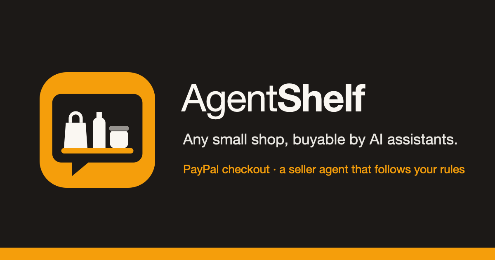
</p>

<h3 align="center">Shoppers now ask Claude or ChatGPT to buy things for them.<br>AgentShelf lets any small shop sell to those AI shoppers, get paid with PayPal,<br>and hand the after-sale work to its own agent.</h3>

<p align="center">
  <a href="https://youtu.be/eTzBD86nAHc"></a>
  <a href="https://agentshelf-xsh7.onrender.com"></a>
  <a href="https://agentshelf-xsh7.onrender.com/judges"></a>
  <a href="https://agentshelf-xsh7.onrender.com/start"></a>
</p>

<p align="center">
  
  
  
  
  
  
  <a href="LICENSE"></a>
</p>

<p align="center">
  <a href="https://youtu.be/eTzBD86nAHc">Demo video</a> ·
  <a href="#-see-it-in-5-minutes">See it</a> ·
  <a href="#-the-problem">The problem</a> ·
  <a href="#%EF%B8%8F-how-it-works">How it works</a> ·
  <a href="#-paypal">PayPal</a> ·
  <a href="#-ag-studio">AG Studio</a> ·
  <a href="#-channel3">Channel3</a> ·
  <a href="#%EF%B8%8F-render">Render</a> ·
  <a href="#-guardrails">Guardrails</a> ·
  <a href="#-try-it">Try it</a> ·
  <a href="#-roadmap">Roadmap</a> ·
  <a href="#-run-locally">Run locally</a>
</p>

<p align="center">
  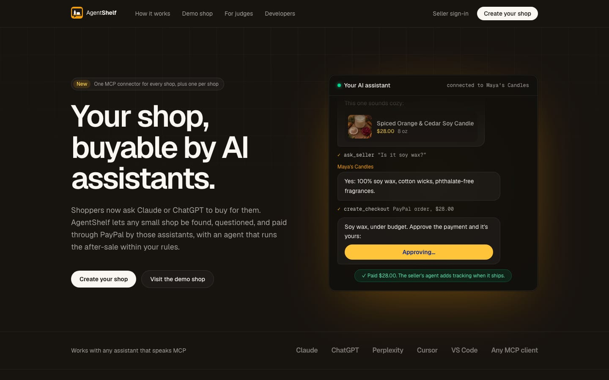
  <br><sub>The whole idea in one chat: the assistant finds a product, asks the seller, checks out with PayPal, and it's paid.</sub>
</p>

---

**AgentShelf** turns any small shop into one that AI assistants can shop in. An assistant like Claude or ChatGPT can search the shop, ask the seller questions, and buy through a **PayPal order the human approves**. After the sale, the shop's own **seller agent** handles refunds, shipment tracking and disputes, but only inside limits the seller sets.

<p align="center"><b><i>"Find me a cozy candle under $30. Is it soy wax? Buy it."</i></b><br><sub>The shopper approves the PayPal payment, and the order appears in the seller's Inbox seconds later.</sub></p>

| 🤖 **Buyable by AI** | 💳 **Paid with PayPal** | 🧑‍💼 **Run by your agent** |
|:---|:---|:---|
| One connector puts every shop in Claude, ChatGPT and any MCP app, with product cards and a Buy button right in the chat. | Every purchase is a real PayPal order (sandbox) the shopper approves. Capture, refunds, tracking and disputes all go through PayPal. | A seller agent refunds within your limits, adds tracking, and drafts dispute replies. Anything bigger waits for your one-click approval. |

<table>
  <tr>
    <td align="center" width="25%"><h3>1</h3><sub>MCP connector for<br>every shop (plus one per shop)</sub></td>
    <td align="center" width="25%"><h3>8</h3><sub>PayPal APIs and SDKs,<br>each doing real work</sub></td>
    <td align="center" width="25%"><h3>5</h3><sub>AI agents (ours + AG Studio's)<br>building one dashboard page</sub></td>
    <td align="center" width="25%"><h3>~2 s</h3><sub>for a shopper's question, answered<br>from the seller's own facts</sub></td>
  </tr>
</table>
<p align="center"><sub>Measured on the live site, Nov 1 2026. Market lookups through Channel3 took 1.5–4.5 s per photo.</sub></p>

## 📸 See it in 5 minutes

**1 · A shop anyone can buy from, people or AI.** The storefront has PayPal buttons for people, and a shop address to paste into Claude or ChatGPT for AI shoppers.

<p align="center">
  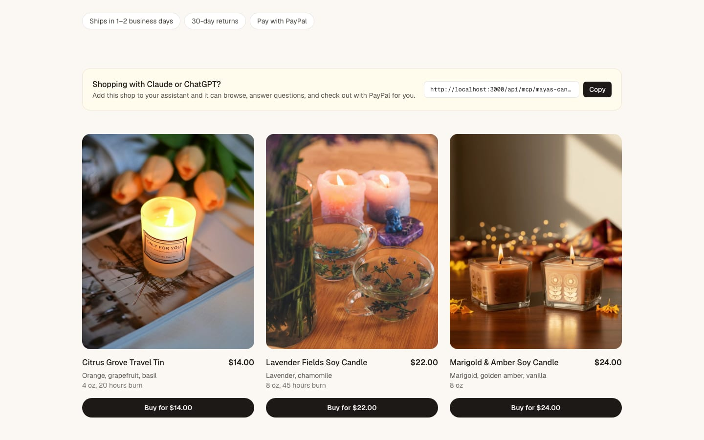
  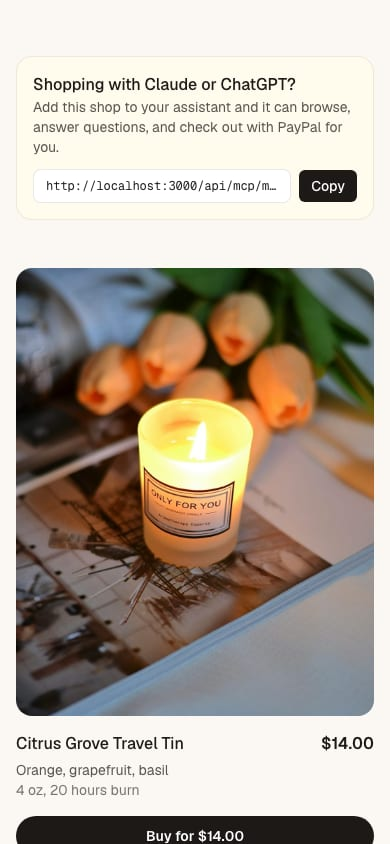
</p>

**2 · The seller's Inbox.** Refunds the agent did by itself, the ones over the limit waiting for approval, PayPal disputes with deadlines, and orders to ship. It updates live as orders arrive.

<p align="center">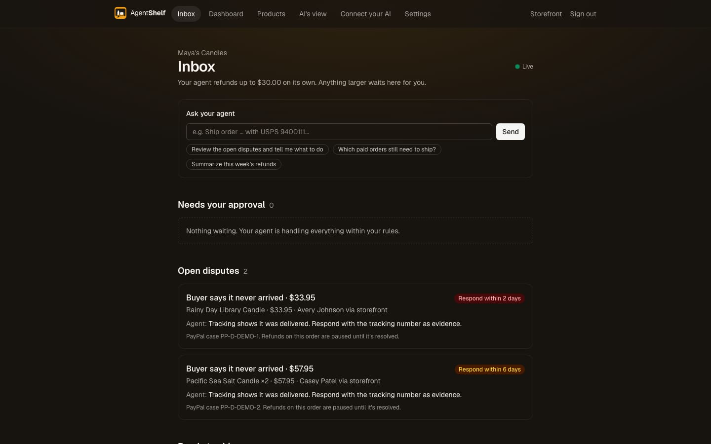</p>

**3 · The dashboard, built with AG Studio.** Sales from AI assistants vs the storefront, which assistant sold what, a live **PayPal dispute countdown** and a live **feed of the agent's actions**. Our two custom widgets sit next to Studio's charts.

<p align="center">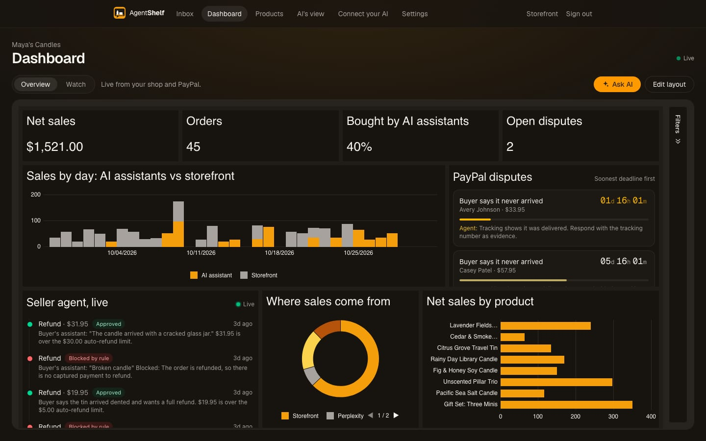</p>

**4 · Ask the dashboard.** *"Would a refund on Priya's order be automatic?"* Studio's lead agent hands the question to **our PayPal seller agent**, which checks the real refund rules. Expand the step to see the verdict card.

<p align="center">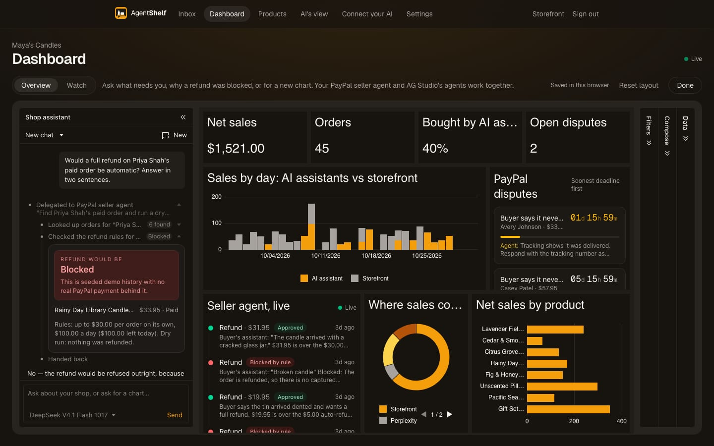</p>

**5 · Studio's agents build pages with our widgets.** *"Add the dispute countdown and the agent feed side by side."* AG Studio's Page agent places **our** custom widgets on an empty page, live, and the page is saved.

<p align="center">
  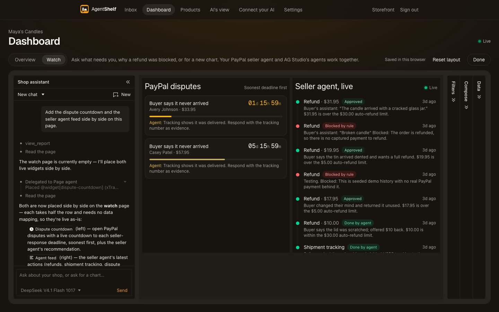
  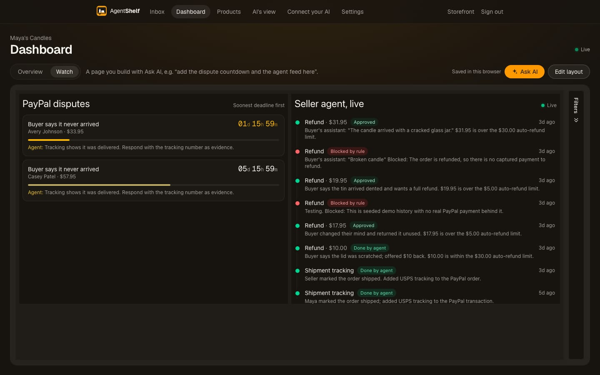
</p>

**6 · Add products from a photo, priced against the market.** AI writes the listing, and **Channel3** finds similar products for sale online, so the suggested price comes with a real market range and examples.

<p align="center">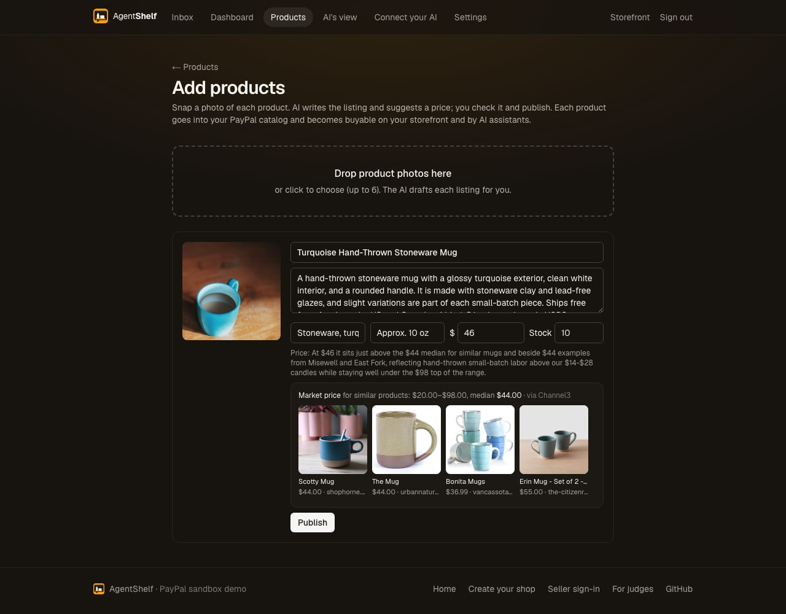</p>

**7 · See your shop the way AI sees it.** An AI-readiness score flags facts an assistant would have to guess, and you can ask questions like a shopper would.

<p align="center">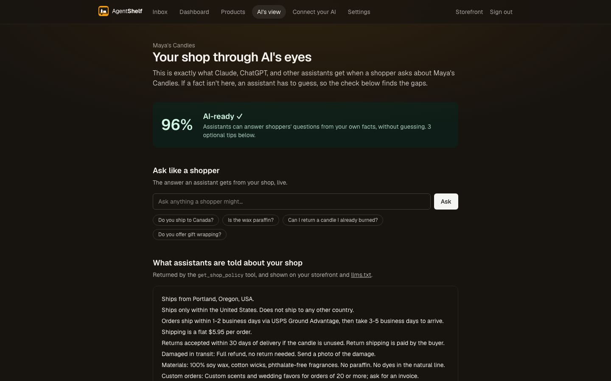</p>

**8 · Anyone can open a shop in a minute,** with sample products that fit what they sell. Their shop joins the marketplace connector straight away.

<p align="center">
  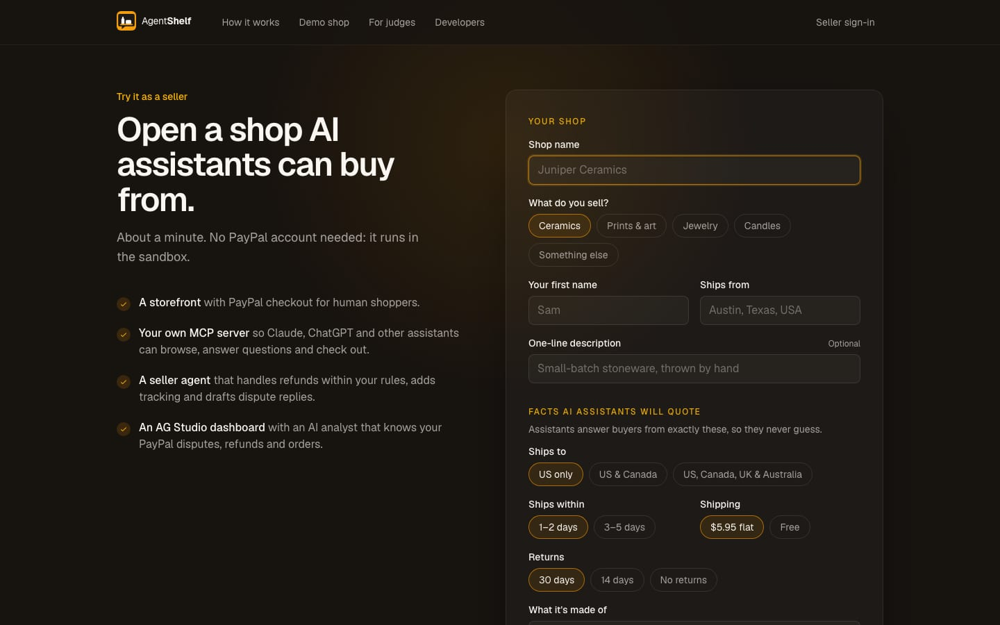
  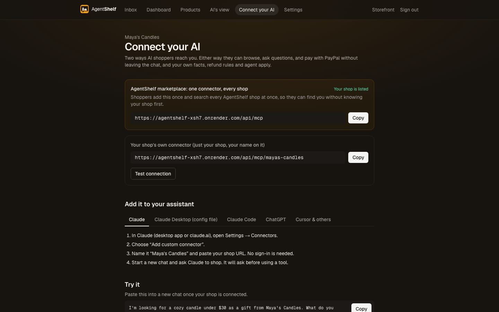
</p>

## 🧩 The problem

AI assistants are becoming shoppers: people now ask Claude or ChatGPT to find and buy things for them. Today those assistants can only buy from big retailers with big engineering teams.

- 🛍️ **Small shops are invisible to AI shoppers.** A candle maker or potter has no way to be found, questioned or paid inside a chat.
- 🤥 **When an assistant doesn't know, it guesses.** "Do you ship to Canada?" gets a confident wrong answer, and the seller pays for it.
- ⏳ **More orders means more after-sale work.** Refunds, tracking and dispute deadlines don't scale for a one-person shop.
- 💸 **Letting an AI touch money is scary** unless the seller sets hard limits it can't cross.

**AgentShelf is the missing layer for small sellers:** a shop AI can buy from, facts AI can't get wrong, PayPal for every payment, and an agent that works inside the seller's rules.

We call it **two front doors**: every shop is beautiful for people **and** crystal-clear for AI, from one source of truth.

## ⚙️ How it works

| | Step | What happens |
|:-:|---|---|
| 1 | **Open a shop** · `/start` | Name, what you sell, and the facts AI will quote (where you ship, returns, materials). Add products from photos. |
| 2 | **AI shoppers find it** · `/api/mcp` | One **AgentShelf marketplace** connector searches every shop; each shop also has its own at `/api/mcp/<shop>`. |
| 3 | **They ask** | `ask_seller` answers only from the seller's own facts. If the shop doesn't ship to Canada, the answer is "No", never a guess. |
| 4 | **They buy** | `create_checkout` makes a **PayPal order**; the shopper approves it in PayPal; we capture it and the order lands in the seller's Inbox. |
| 5 | **The agent follows up** | Small refunds happen automatically, bigger ones wait for approval, tracking goes onto the PayPal order, and disputes get a recommended reply. |
| 6 | **The seller watches** | Inbox and an AG Studio dashboard, both live. Ask the dashboard anything; our agent and Studio's agents answer together. |

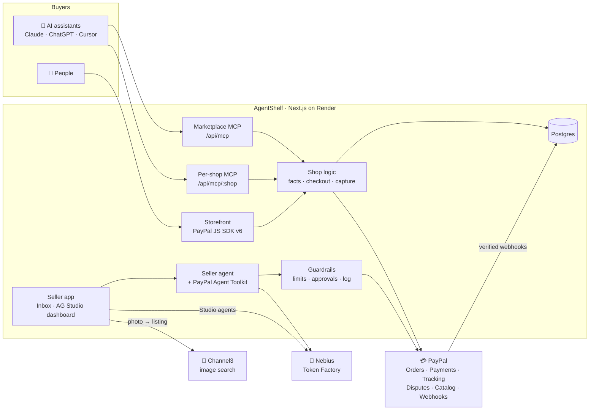

## 💳 PayPal

PayPal is the payment layer for every sale, refund and dispute, and the seller agent works through the **PayPal Agent Toolkit**.

| PayPal product | How AgentShelf uses it | Code |
| --- | --- | --- |
| **PayPal Agent Toolkit** (`@paypal/agent-toolkit`, AI SDK adapter) | The seller agent's read-only tools: `get_order`, `get_refund`, `get_shipment_tracking`, `list_disputes`, `get_dispute`, `list_transactions`, `get_merchant_insights`, `list_products`, `show_product_details`, `list_invoices`, `get_invoice`. `create_product` publishes listings to the catalog. | [`src/lib/paypal/toolkit.ts`](src/lib/paypal/toolkit.ts) |
| **Orders v2** (`@paypal/paypal-server-sdk`) | Orders for AI and human buyers (`custom_id` tags the channel and the assistant), capture on return, shipment tracking. `brand_name` is the shop's name. | [`src/lib/paypal/client.ts`](src/lib/paypal/client.ts) |
| **Payments v2** | Refunds, with the agent action id as `PayPal-Request-Id` so a retry can never refund twice. | [`src/lib/paypal/client.ts`](src/lib/paypal/client.ts) |
| **Catalog Products** | Every product added from a photo is created in the PayPal catalog. | [`src/lib/listings.ts`](src/lib/listings.ts) |
| **Shipment Tracking** | Tracking attached to the PayPal order; PayPal emails the buyer. | [`src/lib/agent/actions.ts`](src/lib/agent/actions.ts) |
| **Disputes** | Dispute webhooks feed the Inbox and the dashboard countdown; the agent reads each dispute and recommends a reply. | [`src/lib/webhooks.ts`](src/lib/webhooks.ts) |
| **Webhooks** | `CHECKOUT.ORDER.APPROVED`, `PAYMENT.CAPTURE.COMPLETED/REFUNDED`, `CUSTOMER.DISPUTE.CREATED/UPDATED/RESOLVED`. Signatures verified (CRC32 + RSA-SHA256 against PayPal's certificate), each event processed once. | [`src/lib/paypal/webhooks.ts`](src/lib/paypal/webhooks.ts) |
| **JS SDK v6** (`@paypal/react-paypal-js/sdk-v6`) | Storefront buttons, with eligibility checks for Venmo and Pay Later. | [`src/app/shop/[slug]/checkout.tsx`](src/app/shop/%5Bslug%5D/checkout.tsx) |

Everything runs against the PayPal **sandbox**; the app refuses to start against live. Tested end to end on the live site: an AI purchase from Claude, PayPal capture, the order in the Inbox, marked shipped, and PayPal's tracking email to the buyer.

> **Who gets paid today?** In this demo, every shop's sales go to one PayPal sandbox business account: AgentShelf's. We tried PayPal Multiparty onboarding (Partner Referrals) so each shop connects its own account, but it needs approval as a PayPal partner (the sandbox answers `403 NOT_AUTHORIZED`). The next step is already enabled on our app: AgentShelf collects each sale, and the seller agent pays each shop through **PayPal Payouts** after it ships, minus a small fee, while refunds and disputes stay with the agent. See the [roadmap](#-roadmap).

## 📊 AG Studio

The seller dashboard is an **AG Studio** report, used the way the prize brief asks: custom widgets, theming, layout, and **our own agent working with Studio's built-in agents**.

| What | How | Code |
|---|---|---|
| **Our PayPal seller agent inside Studio's team** | A `directLlmRunner` agent with custom tools from `api.defineAiTool`: `shop_briefing`, `agent_activity`, `find_orders`, and `check_refund` (a dry run of the real refund guardrails). Read-only: money only moves from the Inbox. | [`studio-ai.ts`](src/app/seller/dashboard/studio-ai.ts) |
| **Our own lead** | Studio's built-in lead, extended with `tools.delegateTo([planning, data, page, widget, seller])`, so one conversation can ask our agent for facts and Studio's agents for charts. | [`studio-ai.ts`](src/app/seller/dashboard/studio-ai.ts) |
| **Our model connection** | A custom `AgLlmAdapter` streams every turn through our server ([`/api/seller/studio/llm`](src/app/api/seller/studio/llm/route.ts)) to Nebius, translating Studio's requests to chat completions and the reply to AG-UI events. No AI key reaches the browser, and a backup model takes over if one is configured. | [`chat-completions.ts`](src/lib/studio-agent/chat-completions.ts) |
| **Two custom widgets** | **Dispute countdown** (ticks live, amber under 3 days, red under 1) and **seller agent feed** (new actions slide in). They query through Studio's data engine, so page filters and cross filters apply, and they carry AI metadata so **Studio's agents can place them**. | [`widgets.tsx`](src/app/seller/dashboard/widgets.tsx) |
| **Detail cards in the chat** | Expanding our agent's steps opens a refund verdict, disputes with time left, the agent's log, or matching orders (`aiToolDisplay`). | [`tool-details.tsx`](src/app/seller/dashboard/tool-details.tsx) |
| **Theme and layout** | A full candlelit theme (`studioTheme.withParams`), a designed overview page, and a **Watch** page to build with AI. Prompt starters and a model picker in the chat. | [`studio-canvas.tsx`](src/app/seller/dashboard/studio-canvas.tsx), [`report.ts`](src/app/seller/dashboard/report.ts) |
| **Saved per shop** | Studio state is saved as the seller or the AI changes it, with one-click reset. The read-only demo shop saves per browser, so judges don't change it for each other. | [`studio-canvas.tsx`](src/app/seller/dashboard/studio-canvas.tsx) |
| **Data the AI understands** | Four tables with relationships, and plain descriptions on tables and fields ("Paid = waiting to ship"), so Studio's agents filter correctly instead of guessing. Updates live. | [`dashboard-data.ts`](src/lib/dashboard-data.ts) |

On the live site, one click on **"Build a live watch page"** had five agents work together: Studio's lead asked our PayPal agent for the live disputes and approvals, Studio's Planning agent designed the page, the Page agent placed nine widgets (our countdown as the main one), and Widget agents configured the rest.

## 🔎 Channel3

When a seller adds a product from a photo, the photo goes to **Channel3 image search** ([`src/lib/channel3.ts`](src/lib/channel3.ts)). Each match's cheapest US-dollar offer gives a **market range and median** (with the extremes trimmed), and the four most typical matches are shown with their photos, prices and stores. The range goes into the listing AI's prompt, so the suggested price is argued against real prices, e.g. *"At $46 it sits just above the $44 median for similar mugs."* When there are too few matches, the screen says so instead of guessing. One credit per photo.

**Market watch** keeps watching after the listing is live. Each product's name and photo find similar products for sale (Channel3 search), and AgentShelf **subscribes to their prices** (Channel3 product subscriptions, free). When a store changes a price, Channel3's signed webhook ([`/api/webhooks/channel3`](src/app/api/webhooks/channel3/route.ts), Standard Webhooks signature checked, each event applied once) updates it, and the seller agent's log says what moved: *"A Light Read Book Candle at macys.com dropped from $45.00 to $31.50. Similar products now sell for a $44.47 median; yours is $28.00 (−37%)."* The Products page shows each product's market range and how far it sits from the median, and the AG Studio dashboard gets a **Market** table, so *"Am I priced right?"* in Ask AI charts your prices against the market ([`src/lib/market.ts`](src/lib/market.ts)).

## ☁️ Render

AgentShelf runs on **Render** from a Blueprint ([`render.yaml`](render.yaml)): a Node web service and a managed Postgres database. Every push to `main` deploys automatically. Before each deploy goes live, Render runs the database migrations, seeds the showcase shops if missing, backfills demo data, and deletes expired visitor shops, so a deploy never needs a manual step.

[](https://render.com/deploy?repo=https://github.com/zaxcoraider/AgentShelf)

## 🧠 How AI is used

| Job | Model (via Nebius Token Factory) | Code |
| --- | --- | --- |
| Seller agent: tool calling over PayPal and shop data | `deepseek-ai/DeepSeek-V4.1-Flash-1017` | [`seller-agent.ts`](src/lib/agent/seller-agent.ts) |
| Answering shopper questions from the policy only (`ask_seller`) | `deepseek-ai/DeepSeek-V4.1-Flash-1017` | [`shop.ts`](src/lib/shop.ts) |
| AG Studio dashboard agents (our lead, our PayPal agent, Studio's built-ins) | `deepseek-ai/DeepSeek-V4.1-Flash-1017` | [`studio-ai.ts`](src/app/seller/dashboard/studio-ai.ts) |
| Photo → listing (vision, structured output), priced with Channel3 | `moonshotai/Kimi-K3` | [`listings.ts`](src/lib/listings.ts) |

Models were picked by testing on our own tasks: streamed tool calls and strict JSON. When Nebius deprecated our first model on Nov 1, we benchmarked four replacements and moved to the fastest (0.5–0.7 s per tool call). All AI calls go through one OpenAI-compatible module ([`src/lib/ai.ts`](src/lib/ai.ts)) with a backup provider: if Nebius fails, the same call retries on **Gemini 3.5 Flash through the DGrid AI gateway**, the only one of 8 backup models we tested that passed all four checks (text, strict JSON, tool calls, vision). Changing models is a settings change.

**Facts AI can't get wrong.** Each shop's shipping, returns and materials are structured fields ([`shop-facts.ts`](src/lib/shop-facts.ts)), served the same way to people (storefront), assistants (`get_shop_policy`, `ask_seller`), search engines (schema.org JSON-LD) and [`/llms.txt`](https://agentshelf-xsh7.onrender.com/llms.txt). What a shop doesn't do is stated as plainly as what it does.

## 🛡 Guardrails

The agent can't go rogue with money. The model never gets PayPal's raw `create_refund`, `accept_dispute_claim` or invoice-sending tools. Money moves only through `refund_order`, which runs these rules in code ([`guardrails.ts`](src/lib/agent/guardrails.ts), unit-tested):

- Refunds up to the seller's limit ($30 for Maya, editable in Settings) run automatically; larger ones wait in the Inbox for one-click approval.
- At most $100 of automatic refunds per day; past that, everything waits for the seller.
- Never more than what's left on the order. Never on an order in dispute, unpaid, or already refunded.
- The agent never turns a buyer down on its own. When the policy doesn't clearly cover a request, it escalates with a recommendation.
- Two refunds at the same moment can't both pass: each decision runs one at a time per shop, and the amount is reserved on the order before PayPal is called. Tested on the sandbox with four refunds fired at once.
- A buyer's assistant can request a refund only with the email the buyer paid with, and nothing is charged until the buyer approves the payment in PayPal.
- Every action is logged with the agent's reason, including blocked and failed ones.

## 🚀 Try it

| | |
|---|---|
| 🎬 **Demo video** | **[Watch on YouTube](https://youtu.be/eTzBD86nAHc)** (2:21): Claude shops four stores and pays with PayPal, the seller agent refunds within limits, and AG Studio's agents build a page with ours. |
| 🧭 **Judge's guide** | **[/judges](https://agentshelf-xsh7.onrender.com/judges)**: four short paths (buyer, AI assistant, seller, your own shop) and where every feature lives. |
| 🛍 **As a buyer** | Open **[Maya's Candles](https://agentshelf-xsh7.onrender.com/shop/mayas-candles)** and buy with the PayPal **sandbox** buyer (login in the Devpost submission). |
| 🤖 **Through Claude or ChatGPT** | Add `https://agentshelf-xsh7.onrender.com/api/mcp` as a custom connector, then ask: *"Find me a handmade gift under $40 on AgentShelf that ships to Canada, then check out the best one."* Four shops answer with their own rules: candles and ceramics ship only in the US, prints and jewelry ship to Canada. |
| 🧑‍💼 **As the seller** | **[Seller sign-in](https://agentshelf-xsh7.onrender.com/signin)** as Maya (password in the Devpost submission): Inbox, Dashboard → **Ask AI**, Products, Settings. Approving a refund on seeded history shows exactly what would happen and changes nothing, so the next judge sees the same Inbox; your own sandbox purchase refunds for real. |
| 🏪 **With your own shop** | **[Create your shop](https://agentshelf-xsh7.onrender.com/start)** in a minute and try editing everything. |

Shops run in the PayPal sandbox: no real money moves. The marketplace has four permanent shops (Maya's Candles, Juniper Clay Studio, Fernwood Print Studio, Saltwater Silver), plus any shop you create. The showcase shops are read-only on the live site, so every judge sees the same demo.

## 🗺 Roadmap

<table>
  <tr>
    <th width="33%">✅ Shipped</th>
    <th width="33%">🔜 Next · Nov–Dec 2026</th>
    <th width="34%">🧭 2027</th>
  </tr>
  <tr valign="top">
    <td>
      • Marketplace MCP for every shop + one per shop<br>
      • Product cards with Buy with PayPal in chat (MCP Apps)<br>
      • PayPal orders, capture, refunds, tracking, disputes, catalog, webhooks<br>
      • Seller agent with guardrails and an approval Inbox<br>
      • AG Studio dashboard with our agent in Studio's team<br>
      • Photo → listing with Channel3 market prices<br>
      • Market watch: competitor price alerts via Channel3 webhooks<br>
      • Create your own shop, products and settings<br>
      • A four-shop marketplace with different shipping rules<br>
      • Facts AI can't get wrong: MCP, JSON-LD, llms.txt<br>
      • Live on Render, deployed on every push
    </td>
    <td>
      • <b>Sellers get paid</b>: AgentShelf collects each sale, then the seller agent pays the shop's PayPal account with <b>PayPal Payouts</b> after shipping, minus a small fee. Refunds and disputes stay with the agent<br>
      • <b>Agent answers disputes with evidence</b> (tracking), after the seller approves<br>
      • <b>Invoices for custom orders</b> drafted by the agent<br>
      • <b>Pay Later messaging</b> on every storefront<br>
      • <b>One shelf photo → many listings</b> with Channel3<br>
      • <b>Dashboard widgets that filter each other</b> on click, plus an AI usage meter (AG Studio)<br>
      • <b>Morning brief</b> from the seller agent and nightly cleanup (Render cron jobs)
    </td>
    <td>
      • Listing in the Claude and ChatGPT app directories<br>
      • <b>Each shop connects its own PayPal account</b> (PayPal Multiparty onboarding), once approved as a PayPal partner<br>
      • Pilot with real independent sellers<br>
      • Import from Etsy and Shopify<br>
      • More currencies and countries<br>
      • A fee on AI-assisted sales plus a seller subscription
    </td>
  </tr>
</table>

## 🛠 Run locally

Needs Node.js 22+ and a PayPal developer account (sandbox). No database install: locally AgentShelf uses PGlite, an embedded Postgres stored in `.data/`.

```bash
git clone https://github.com/zaxcoraider/AgentShelf.git
cd AgentShelf
npm install
cp .env.example .env    # add your PayPal sandbox app's client id and secret, plus an AI key
npm run db:setup        # creates the tables and the Maya's Candles demo shop
npm run dev             # http://localhost:3000
```

The shop, MCP servers and checkout work with PayPal keys alone. The seller agent, photo → listing, AI answers and the dashboard's Ask AI turn on with `AI_BASE_URL`, `AI_API_KEY` and the `AI_MODEL_*` variables. Market prices need `CHANNEL3_API_KEY`; the AG Studio watermark goes away with `AG_STUDIO_LICENSE_KEY`.

<details>
<summary><b>Useful scripts</b></summary>

| Script | What it does |
| --- | --- |
| `npm test` | Unit tests (guardrails, webhook parsing, market price maths) |
| `npm run smoke:ai` | Text, streaming, structured output, tool calling and vision against the configured models |
| `npm run smoke:mcp` | Shops like an AI assistant against the running app, ending with a real sandbox order |
| `npm run smoke:seller-agent -- --mock` | Checks the agent's tools and guardrails with a scripted model (no AI key needed) |
| `npm run smoke:seller-agent` | The real model reviews the shop's open disputes |
| `npm run smoke:webhook` | Replays sample PayPal webhooks against the local database |
| `npm run db:seed -- --reset` | Rebuilds the demo shop from scratch |

</details>

<details>
<summary><b>Deploy your own</b></summary>

Use the **Deploy to Render** button above, or in Render choose **New → Blueprint** and pick this repo. Fill in the PayPal and AI variables. Then register `https://<your-app>/api/webhooks/paypal` in the PayPal developer dashboard (or run `npm run paypal:webhook -- <url>`) and set `PAYPAL_WEBHOOK_ID`.

</details>

<details>
<summary><b>Project layout</b></summary>

```
src/app/                pages: home, /start, /signin, /judges, /shop/<shop>, /checkout/return
src/app/seller/         Inbox, Dashboard (AG Studio), Products, Add products, AI's view, Connect, Settings
src/app/api/mcp/        marketplace MCP (route.ts) and per-shop MCP ([slug]/route.ts)
src/app/api/seller/     dashboard data + state, Studio LLM proxy and tools, live Inbox
src/lib/mcp/            MCP servers and the product-card widget (MCP Apps)
src/lib/agent/          seller agent, guarded actions, guardrails
src/lib/paypal/         PayPal client, Agent Toolkit adapter, webhook verification
src/lib/studio-agent/   AG Studio agent tools and the chat-completions translator
src/lib/                shop logic, shop facts, marketplace, Channel3, listings, AI module
scripts/                seed, migrations, smoke tests, demo photos (credited)
```

</details>

## 🔐 Security and privacy

- **Keys stay on the server.** PayPal, AI and Channel3 keys never reach the browser; the dashboard's AI runs through our own proxy.
- **Sandbox only.** The app refuses to start against live PayPal.
- **Verified webhooks.** Every PayPal webhook signature is checked, and each event is processed once.
- **Passwords are hashed** (scrypt); sign-in helpers can't be called from outside the server.
- **Sessions can't be forged.** Cookies are signed with a server-only key (never the shared demo password) and name the shop's unique id, so an old cookie can't open a newer shop with the same name.
- **Every seller action is scoped to its own shop**, and every agent action is logged with its reason.
- **Fair-use limits** on every AI feature and on starting checkouts, per shop and per visitor, plus a daily ceiling for the whole site, so nobody can drain the AI credit or flood a shop with unpaid orders. Over the limit, `ask_seller` still returns the shop's facts.
- **Uploads are checked**: a photo must really be a JPEG, PNG or WebP, not just named like one.
- **Standard security headers** (HSTS, nosniff, no framing by other sites, camera and microphone off).
- **Demo limits:** 3 new shops per visitor per day, 100 per day site-wide, 20 products per shop, and visitor shops are deleted after 30 days.

## 🙏 Credits

Demo product photos are from [Unsplash](https://unsplash.com) (see [`scripts/seed-photos/CREDITS.md`](scripts/seed-photos/CREDITS.md)). Built with Next.js 15, React 19, Tailwind CSS 4, Motion, the Vercel AI SDK, the MCP TypeScript SDK + MCP Apps, AG Studio, the PayPal Agent Toolkit, PayPal Server SDK and JS SDK v6, Drizzle ORM, Postgres / PGlite, Nebius Token Factory, Channel3 and Render.

---

<p align="center">
  <br>
  <sub>Built for <a href="https://paypalaihackathon.devpost.com"><b>Build What's Next with PayPal and AI</b></a> · <a href="LICENSE">MIT License</a></sub>
</p>
