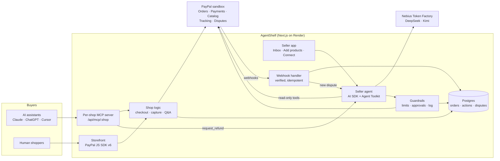

<p align="center"></p>

# AgentShelf

**Any small shop, buyable by AI assistants, with PayPal checkout and a seller agent that follows your rules.**

AI assistants are becoming shoppers, but they can only buy from big stores. AgentShelf gives every small seller a shop that Claude, ChatGPT, and other assistants can browse, question, and buy from with PayPal. A seller agent then handles the after-sale work (refunds, shipment tracking, disputes) inside limits the seller sets.

Built for [Build What's Next with PayPal and AI](https://paypalaihackathon.devpost.com). Demo shop: **Maya's Candles**, a one-person candle studio.

## What it does

| | Feature | Where |
| --- | --- | --- |
| 📸 | **Photo → listing.** Drop in product photos; a vision model drafts the title, description, scent, size, and a price that fits the shop. Publishing creates the product in the seller's **PayPal catalog** via the Agent Toolkit. | `/seller/listings` |
| 🤖 | **A shop AI assistants can buy from.** Every shop has its own MCP server: search, product details, questions answered from the seller's policy, checkout as a **PayPal order** the buyer approves, order status, and refund requests. | `/api/mcp/<shop>` |
| 🔌 | **Connect your AI.** The shop's MCP URL, a live connection test, and setup steps for Claude, Claude Desktop, Claude Code, ChatGPT, and Cursor. | `/seller/connect` |
| 🛍️ | **Storefront for humans.** The same catalog with **PayPal JS SDK v6** buttons. | `/shop/<shop>` |
| 🧾 | **Seller agent.** Reviews buyers' refund requests against the shop policy, refunds within the rules, escalates the rest, adds tracking, and recommends how to answer disputes. The seller can also give it instructions in plain English. | `src/lib/agent/` |
| ✅ | **Seller Inbox.** Approval queue for refunds over the limit, orders to ship, open disputes with response-deadline countdowns, and a filterable log of everything the agent did. | `/seller/inbox` |
| 🔔 | **Webhooks.** Verified PayPal webhooks keep orders, refunds, and disputes in sync, even when the buyer closes the tab before returning, or the seller refunds in PayPal directly. | `/api/webhooks/paypal` |

## PayPal APIs and SDKs used

| PayPal product | How AgentShelf uses it | Code |
| --- | --- | --- |
| **PayPal Agent Toolkit** (`@paypal/agent-toolkit`, AI SDK adapter) | The seller agent's read-only tools: `get_order`, `get_refund`, `get_shipment_tracking`, `list_disputes`, `get_dispute`, `list_transactions`, `get_merchant_insights`, `list_products`, `show_product_details`, `list_invoices`, `get_invoice`. `create_product` publishes listings to the catalog. | `src/lib/paypal/toolkit.ts` |
| **Orders v2** (`@paypal/paypal-server-sdk`) | Create orders for AI and human buyers (`custom_id` tags the channel and assistant), capture on return, read orders, add shipment tracking. | `src/lib/paypal/client.ts` |
| **Payments v2** | Refund captures, with the agent action id as `PayPal-Request-Id` so a retry can never refund twice. | `src/lib/paypal/client.ts` |
| **Catalog Products** | Products created from photo onboarding (via the toolkit). | `src/lib/listings.ts` |
| **Shipment Tracking** | Tracking attached to the PayPal order; PayPal notifies the buyer. | `src/lib/agent/actions.ts` |
| **Disputes** | Dispute webhooks feed the Inbox; the agent reads disputes and recommends a response. | `src/lib/webhooks.ts` |
| **Webhooks** | `CHECKOUT.ORDER.APPROVED`, `PAYMENT.CAPTURE.COMPLETED`, `PAYMENT.CAPTURE.REFUNDED`, `CUSTOMER.DISPUTE.CREATED/UPDATED/RESOLVED`. Signatures verified (CRC32 + RSA-SHA256 against PayPal's cert), each event processed once. | `src/lib/paypal/webhooks.ts` |
| **JS SDK v6** (`@paypal/react-paypal-js/sdk-v6`) | Storefront checkout buttons, with eligibility checks for Venmo and Pay Later. | `src/app/shop/[slug]/checkout.tsx` |

Everything runs against the PayPal **sandbox**; the app refuses to start against live.

## How AI is used

| Job | Model (via Nebius Token Factory) | Code |
| --- | --- | --- |
| Seller agent: tool calling over PayPal + shop data | `deepseek-ai/DeepSeek-V4.1-Flash` | `src/lib/agent/seller-agent.ts` |
| Photo → listing (vision, structured output) | `moonshotai/Kimi-K3` | `src/lib/listings.ts` |
| Answering shopper questions from the policy only (`ask_seller`) | `deepseek-ai/DeepSeek-V4.1-Flash` | `src/lib/shop.ts` |

Models were chosen by testing on our own tasks: a refund the policy covers, one it doesn't (used candle, "scent too strong"), reviewing real disputes with all 17 tools, and grounded Q&A where the honest answer is "not sure". All AI calls go through one OpenAI-compatible module (`src/lib/ai.ts`) with a fallback provider, built on the [Vercel AI SDK](https://ai-sdk.dev). Any compatible provider or model is an environment-variable change.

## Guardrails: the agent can't go rogue with money

The model never gets PayPal's raw `create_refund`, `accept_dispute_claim`, or invoice-sending tools. Money moves only through `refund_order`, which runs these rules in code (`src/lib/agent/guardrails.ts`, unit-tested):

- Refunds up to the seller's limit ($30 for Maya) run automatically; larger ones wait in the Inbox for one-click approval.
- At most $100 of automatic refunds per day; past that, everything waits for the seller.
- Never more than what's left on the order. Never on an order in dispute, unpaid, or already refunded.
- The agent never turns a buyer down on its own. When the policy doesn't clearly cover a request, it escalates with a recommendation.
- Buyers' assistants can request refunds only with the email the buyer paid with, and nothing is charged until the buyer approves the payment in PayPal.
- Every action is logged with the agent's reason, including blocked and failed ones.

## Architecture



## Try it

**Hosted demo:** coming soon (Render).

**Connect your AI to the demo shop:** open `/seller/connect` for the MCP URL and setup steps. Then ask your assistant something like:

> I'm looking for a cozy candle under $30 as a gift from Maya's Candles. Ask the seller if it's soy wax, then check out the best one for me.

The assistant returns a PayPal link; approve it with a PayPal **sandbox** buyer account (login details are in the Devpost submission).

**Seller side** (`/seller/*`: Inbox, Add products, Connect your AI) asks for the demo password, also in the Devpost submission. Locally, leave `SELLER_DEMO_PASSWORD` empty and it opens without one.

## Run it locally

Needs Node.js 22+ and a PayPal developer account (sandbox). No database install: locally AgentShelf uses PGlite, an embedded Postgres stored in `.data/`.

```bash
git clone https://github.com/zaxcoraider/AgentShelf.git
cd AgentShelf
npm install
cp .env.example .env    # add your PayPal sandbox app's client id and secret, plus an AI key
npm run db:setup        # creates the tables and the Maya's Candles demo shop
npm run dev             # http://localhost:3000
```

The shop, MCP server, and checkout work with PayPal keys alone. The seller agent, photo → listing, and AI answers turn on when `AI_BASE_URL`, `AI_API_KEY`, and the `AI_MODEL_*` variables are set (see `.env.example`).

Useful scripts:

| Script | What it does |
| --- | --- |
| `npm test` | Unit tests (guardrails, webhook parsing) |
| `npm run smoke:mcp` | Shops like an AI assistant against the running app, ending with a real sandbox order |
| `npm run smoke:seller-agent -- --mock` | Checks the agent's tools and guardrails with a scripted model (no AI key needed) |
| `npm run smoke:seller-agent` | The real model reviews the shop's open disputes |
| `npm run smoke:webhook` | Replays sample PayPal webhooks against the local database |
| `npm run db:seed -- --reset` | Rebuilds the demo shop from scratch |

## Deploy

`render.yaml` is a Render Blueprint: a Node web service plus Postgres, with migrations and the demo seed running before each deploy. In Render choose **New → Blueprint**, pick this repo, and fill in the PayPal and AI variables. Then register `https://<your-app>/api/webhooks/paypal` in the PayPal developer dashboard and set `PAYPAL_WEBHOOK_ID`.

## Built with

Next.js 15 · React 19 · Tailwind CSS 4 · Vercel AI SDK · Model Context Protocol TypeScript SDK · PayPal Agent Toolkit · PayPal Server SDK · PayPal JS SDK v6 · Drizzle ORM · Postgres / PGlite · Nebius Token Factory · Render

## License

[MIT](LICENSE)
